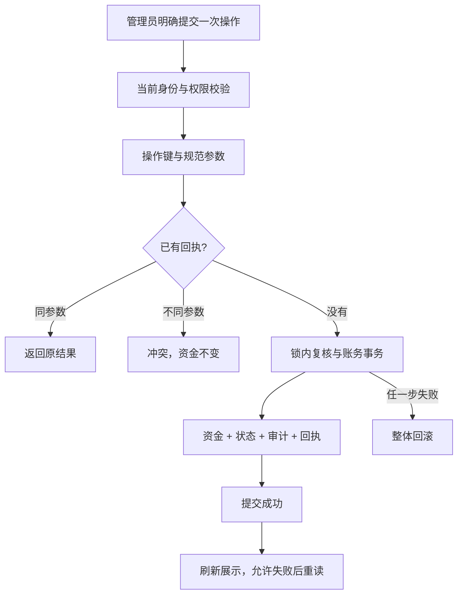

# Agent Note: 企业资金操作与异常收尾优化方案

Status: proposed

## Problem

用户要求从第一性原理进行对抗性审查，兼顾便捷与安全，并把后续优化方案交给本任务制定。目标是：管理员完成一次明确的资金操作，断网、重复点击、进程退出或迟到任务都不会让它变成两次；发生异常时，能从后台找到证据并完成收尾；已经归档的企业继续保留准确历史。

初稿交付设计与验收方案；2026-11-17用户授权在本地开始第一批实施，见[资金操作决策](../../implemented/feature/2026-11-17-enterprise-financial-operations.md)。不调整线上额度、不请求真实上游、不提交或发布，也不删除旧文档。下文的接口、表和状态是拟议契约，不是已经上线的能力。

审查基线为 GitHub `main` 的 `0ae9720876e39754893e8a8270d3310ee031ff36`（v1.37.0，2026-11-17）。本地HEAD是归档功能提交`bbccc23e2`；Git fetch超时，改用GitHub Contents/Compare API逐项核对相关文件，并读取不同文件的远端版本。企业钱包、人工对账、归档、任务账务、权限路由及相关弹窗与基线一致。取价、任务定价快照，以及共享relay文件中的输入能力选路、Responses流错误和输出观测有主线变化；已读取远端差异，实施不能基于旧工作区覆盖它们。生产数据库、真实未结算任务、实际启用开关本轮均未读取。

## Existing capabilities and impact

### 已有能力与本次复用

| 用户操作 | 已有入口与数据链路 | 复用或扩展 |
| --- | --- | --- |
| 入账、调账 | [WalletModal](../../../../web/src/pages/EnterpriseAdmin/WalletModal.jsx) → 平台Root路由 → [controller](../../../../controller/enterprise.go) → [EnterpriseLedger/钱包事务](../../../../model/enterprise_wallet.go) | 保留已有凭证、原因、权限、整数额度；增加持久操作回执及安全重试 |
| 分配、回收 | [AmountModal](../../../../web/src/pages/EnterpriseConsole/AmountModal.jsx) → 企业成员权限 → `enterpriseMemberAmount` → 企业/成员行锁与内部划拨流水 | 共用操作回执；补齐原始单位输入、全部回收与提交结果恢复 |
| 申请审批 | [申请状态机](../../../../model/enterprise_request.go)、[企业开通申请](../../../../model/enterprise_application.go) | 已有申请ID及状态条件防止重复批准；保留，纳入整体验收，不再造一套审批 |
| 人工处理预留 | [Reservations](../../../../web/src/pages/EnterpriseAdmin/Reservations.jsx) → Root → [ResolveEnterpriseReservation](../../../../model/enterprise_reservation.go) | 将资金、处理状态、审计和回执合为一个事务；关联异步任务统一处理 |
| 异步结算 | [通用任务账务](../../../../model/enterprise_task_billing.go)、[MJ账务](../../../../model/enterprise_mj_billing.go)、[后台维护](../../../../service/enterprise_maintenance_task.go) | 复用原付款主体、绝对最终金额、既有幂等事件和轮询；补可核实的人工收尾与公平重试 |
| 企业归档 | [预检与事务](../../../../model/enterprise_archive.go)、[ArchiveModal](../../../../web/src/pages/EnterpriseAdmin/ArchiveModal.jsx) | 保留冻结、守恒、零净余额和终态检查；增加可定位的阻塞详情，不降低归档门槛 |
| 历史核查 | [HistoryModal](../../../../web/src/pages/EnterpriseAdmin/HistoryModal.jsx)、[用量筛选与导出](../../../../controller/enterprise_usage.go)、[账务查询](../../../../model/enterprise_usage.go) | 接上已有筛选/CSV；复用主库账源，补原始金额、来源关联和审计详情 |
| 应用更新/回退 | [受保护发布入口](../../../../scripts/newapi-release)及`newapi-update/newapi-rollback/newapi-restart` | 在原入口加数据能力兼容检查，沿用在线备份、发布锁和健康验证 |
| 持久去重模式 | [现金凭证](../../../../model/upstream_cash_account.go)、[资金回执](../../../../model/upstream_cash_wallet.go)已有request key + payload hash +事务 | 复用设计和验证方式；企业额度不写入采购现金表，不将两套资金语义混在一起 |

### 本轮源码确认的缺口

以下是可由源码确认的失败窗口，不代表已经发生生产事故；本轮没有对生产做故障注入。

| 编号 | 优先级 | 现状证据与触发方式 | 影响 |
| --- | --- | --- | --- |
| F01 | P1 | `AdjustEnterprise`、`AllocateEnterpriseQuota`、`ReclaimEnterpriseQuota`没有持久操作编号；浏览器收到失败后可再次发POST | 上一次已提交但响应丢失时，第二次请求可能再次加减额度。按钮防连点不能跨刷新/多实例保证只处理一次 |
| F02 | P1 | `enterpriseMemberAmount`先完成划拨，再调用`GetEnterpriseMemberDetail`；后一次查询失败仍返回操作失败 | 资金已变化，但界面提示失败，容易诱发重复操作 |
| F03 | P1 | `ResolveEnterpriseReservation`先提交`adjustEnterpriseReservation`，再开启另一个事务写审计 | 资金成功、审计失败时无法整体回滚；失败后的重复/并发处理可能缺失或重复审计 |
| F04 | P1 | 人工预留处理没有一起更新Task/MJ账务终态；`ReconcileEnterpriseMJ`只选择accepted/rejected，不处理unknown | 释放/结算了预留仍可能无法归档；随后的自动结算可能与人工决定冲突，不能靠改标记强行通过 |
| F05 | P1交付门槛 | `command_rollback`检查镜像身份并切换，但没有依据已使用的企业数据能力判断目标程序能否正确读取/写入 | 旧程序可能不认识归档、人工封账或幂等回执；有列不等于行为兼容 |
| F06 | P2 | 归档预检返回阻塞代码和数量，没有具体任务/请求清单及处理跳转 | 管理员知道不能归档，却找不到下一步处理对象 |
| F07 | P2 | 成员额度与人工对账的InputNumber仍为两位小数；归档历史只有基础分页 | 微额操作和核账不便，存在显示精度误导；接口已有能力未在页面贯通 |
| F08 | P2 | 恢复扫描按ID取固定前N条，失败只写日志；早期长期失败条目每轮仍占据队头 | 满批坏记录可能反复挤占后续恢复机会；需设计公平调度并用合成数据复现，不能凭代码推断生产已经积压 |

补充发现（2026-11-17用户追问生图成本后）：

- **F09 / P1：失败退款与上游成本分离。** 图片发送/响应失败会进入用户预扣退款，但没有同步核实供应商收费；已有局部禁止重发保护，仍需审查其他错误重试与跨入口生图。用户反馈的“失败上游仍扣费”会形成平台损耗，需同时处理恢复交付和费用证据。
- **F10 / P1：企业任务仍受通用超时清理影响。** `sweepTimedOutTasks`与`GetTimedOutUnfinishedTasks`没有排除企业付款方；定时写失败可触发企业退款。新增人工/自动仲裁必须覆盖这条入口，不能只修企业专用维护任务。普通任务既有策略在独立验收前保持。

### 不改变的产品规则

- 企业继续使用平台已支持、账号获授权的API能力；不另设“企业视频未开放”等能力限制，不建立第二套供应商路由。
- 企业钱包与个人钱包隔离。资金主体始终是受理时的企业ID、成员代次、用户ID和令牌ID，不能用后来重新加入的成员关系替换。
- Owner可以处理本人预算/额度申请；Admin不能自批本人申请。Root仍负责入账、调账、人工账务处理和归档，不新增所有资金操作都要双人批准的流程。
- 最新v1.37.0已增加模型“不参与折扣”设置，适用于企业和个人取价：普通模型沿用企业所选组倍率；明确设置不参与折扣的模型走当前主线规则。旧任务按原请求快照结算，不能恢复旧版“所有模型必然0.8倍”的假设。此方案不修改已有价格政策。
- 归档是不可恢复终态；未结清资金或未确认任务不能自动清零。平台额度调整不等于外部银行款项已经退回。
- 保持现有整体UI和语言体系。只补主操作、状态及错误恢复；信息解释放按需详情，不加常驻教学段落。

## Proposal

### 1. 基本约束

1. **一项意图最多产生一次财务效果。** 同一操作键重复提交返回原回执，不能再次变化资金；相同金额的两项合法独立意图不能被时间窗口误判为重复。
2. **状态、资金、审计、回执共同提交。** 任一写入失败都回滚；界面刷新、邮件和非权威日志失败不能推翻已提交的财务事实。
3. **未知结果就是未知。** 超时不是失败，不是退款凭证；界面显示“结果待确认”，系统只查询或同键恢复，不能偷偷换新键重扣。
4. **守恒式始终成立。** `NetCredited = Unallocated + Σ(Available + Reserved + Consumed)`。调账同时改未分配和净入账，内部划拨不改企业净资产，结算/退款只改原付款关系。
5. **当前授权与原付款主体分别验证。** 操作者必须有当前操作权限；历史资金仍属于原代次。幂等键不是查看其他企业记录的通行证。
6. **人工与自动结算共享同一最终金额。** 自动轮询、Root处理和进程恢复并发时，只有一方能确定最终账务；另一方要么读原回执，要么报告冲突。
7. **能够操作也必须能够撤销未提交操作、解释结果和定位记录。** 普通分配/回收仍一次提交；永久归档和不可逆账务结清保留一次明确的后果确认。

### 2. 方案骨架与模块边界

用三个职责明确的Module承接六类改进，名称是设计名称，实施时按仓库命名落地：

| Module | 小而明确的Interface | 内部承担的行为 |
| --- | --- | --- |
| 企业资金操作 | `ExecuteEnterpriseOperation(actor, command)`、`GetEnterpriseOperation(actor, key)` | 参数归一化、当前权限、幂等键与载荷绑定、事务、原回执、安全错误映射 |
| 企业异常结算 | `PreviewEnterpriseResolution(actor, source)`、`ResolveEnterpriseWork(actor, decision)` | 原付款主体、证据/版本、Task/MJ差异、最终金额、迟到结果、人工与自动仲裁 |
| 企业管理查询 | `ListEnterpriseCloseoutBlockers(actor, filter)`以及已有用量/流水/审计查询 | 同一筛选口径、权限、分页、脱敏字段、处理链接和导出 |

复用Router → Controller → Service → Model。HTTP层只绑定参数和当前操作者，不拼装第二套扣款逻辑；需要GORM事务的统一协调放在model层。UI不需要了解行锁、状态字段或补扣顺序。这里不构建全站通用工作流引擎，也不重写现有正常调用计费。

### 3. P1-A：资金操作防重复与可恢复结果

**数据。** 新增轻量`EnterpriseOperation`回执表，不把EnterpriseLedger改造成业务调度表：

- 单一唯一`request_key_hash`：服务端按当前操作者ID和规范操作键计算SHA-256。完整载荷摘要包含企业ID、动作、目标/成员代次、原始额度、原因、凭证和适用的预检版本；同键换企业/动作/金额均冲突。
- 保存企业/操作者/成员代次、动作、目标、规范载荷摘要、关联资金流水/预留/审计ID、事务内结果及时间。结果只含本次变动、相关ID及“当时余额”，不返回整个用户或成员对象。
- 键用固定长度ASCII编码，载荷用`common.Marshal`规范结构体计算，金额用整数。SQLite/MySQL5.7/PostgreSQL9.6使用GORM、唯一索引和TEXT，不依赖JSON数据库运算。
- 只在成功财务事务里形成可见的已完成回执；回执、相关流水与去重依据同生命周期保留。后续如要清理，至少保留键和载荷摘要的拒绝重放记录，不能到期删除后让旧请求重新执行。
- 复用已有入账凭证唯一约束。换操作键但复用同一转账凭证仍被拒；已有申请ID和审批状态条件继续兜住重复批准，不强制把所有领域对象替换成操作表。

**写入契约。** 既有URL保留，新增`Idempotency-Key`请求头和统一`operation_id/replayed`结果字段，金额字段保持兼容。界面自动生成键，用户不用抄编号。

| 情况 | 服务端行为 | 界面行为 |
| --- | --- | --- |
| 首次合法提交 | 事务内校验并产生一次资金效果与回执 | 显示“已完成”，随后刷新余额 |
| 同键同内容重试 | 当前权限通过后返回原回执，不重扣；不受当前余额变动影响重新执行 | 显示已处理结果；余额另行刷新 |
| 同键不同内容 | 返回稳定业务码`operation_conflict`，不写入 | 保留表单，说明该操作编号已用于另一笔内容 |
| 网络/网关超时、响应丢失 | 不能据此声明账务失败 | 显示“结果待确认”；读主库回执，允许同键同内容重试 |
| 查询暂时无回执 | 可能有事务尚未提交；不是换新键的凭据 | 保持原键，不能自动开始另一笔 |
| 已完成但余额刷新失败 | 原回执仍成功，独立返回刷新失败 | “已完成，余额待刷新”；不诱导再次点击扣款 |
| 已被撤权/账号停用 | 重放和查询同样重新鉴权；无权不返回财务详情 | 提示权限已变；Root可从审计查询原结果 |

**事务顺序。** 进入变更前校验当前身份；管理操作仍先企业行、再受影响成员ID升序，随后操作源对象和既有计费依赖。先在锁内查原回执，同键同载荷已完成直接返回；新操作再校验可写状态、余额、额度范围并执行。仍有历史读取权限的操作者，在企业已冻结/归档后也可取回原回执，不重新写账；不能先用现有`enterpriseTx`的归档拒绝分支挡住这项只读恢复。唯一索引是跨实例最终防线；跨企业同键竞争导致唯一冲突时，先结束/回滚当前事务，再从主库核对原回执，不能在持有另一家企业锁时循环等原操作。

不反转现有企业→成员锁序，不让每次正常推理都锁企业行。所有锁等待有界；数据库死锁/中止时允许有限同键重试，网络提交结果未知先读回执，不能盲目重跑。MySQL RR下去重/版本查询不得建立一个早于锁等待的快照后继续用旧读判断，必须用合适的锁定读/新事务验证。

平台资金写入口补主库当前账号状态/角色检查，企业角色沿用事务内读取；不能只信任旧会话的角色。本批只覆盖这些财务入口，不顺带改写全站会话协议。确定授权检查的时点并测试撤权/转Owner与写入交错。不能为了这项检查增加User→Enterprise的反序锁；需要更强串行化时沿已有账号生命周期锁序做专门测试后落地，不承诺Cookie清理能覆盖所有并发。

**前端操作状态。** 共用一个资金提交hook，状态为“编辑 → 提交 → 已完成 / 待确认 / 已拒绝”。首次提交前固定规范金额和操作键；pending期间保存最小已提交草稿用于同键恢复，按站点/账号/企业隔离，优先sessionStorage，不保存密钥、Cookie或整份用户数据。明确账号切换清除可见状态；退出登录清理本机草稿，不删除服务端回执。

提交中不能改动金额、方向、目标，也不能通过连点重发新键。待确认后允许关闭弹窗，列表保留结果查询入口；关闭不表示取消已发出的财务操作。改金额是新意图，必须先辨明上一笔结果；同键重试不是再次确认收费。轮询有最大次数和退避，页面卸载即取消，不留后台空转。

`enterpriseMemberAmount`直接使用事务返回的稳定结果，不再用提交后的成员详情查询决定此次操作成功与否。当前余额查询是独立展示步骤。权威金额和权限从主库校验；缓存刷新失败不能作为改账失败返回，后续读取不得把旧缓存作为安全重试依据。

**便利补齐。** `AmountModal`与人工对账统一复用精确额度输入：常用金额输入、可选原始单位、明确正负方向；“全部回收”引用当次快照的原始可用整数并在提交时复核，不能偷偷回收后来新增的预算。未改金额原样传回，禁止经过浮点换算丢1单位。空白不能当0，结算0须明确选择。保留现有单笔范围，新增累计算术溢出检查；超过JS安全整数的展示/新回执采用原始整数字符串，不能借显示舍入改变真实金额。

### 4. P1-B：人工对账事务一致与任务统一收尾

**第一步先修确定问题。** 提取私有`adjustEnterpriseReservationTx(tx, ...)`，既有公开封装保留。Root人工对账在同一事务内完成：读取原记录和版本 → 付款主体/权限/状态核验 → 资金/令牌预算/消费变更 → 状态 → 审计 → 操作回执。审计编码失败也必须返回错误，不能写空字符串冒充完整审计。邮件、通知、非权威消费日志在提交后执行；其失败不回滚已提交资金，也不作为重复扣费理由。

**第二步统一异常来源。** 从预留或持久任务归属建立轻量`EnterpriseReconciliation`记录，承担证据和人工决定，不承担第二套余额：

- 记录企业、原成员/用户/令牌、请求ID、Task/MJ真实内部ID、来源类型、版本、核实决定、最终原始额度、依据引用/说明、操作者、关联回执和审计ID。
- 一个来源只有一个当前有效结清决定；人工处理与自动终结必须经过同一决策检查。已确认的自动终态不应被普通“重试”改写。
- 通用Task的原RequestId目前在private_data中；为跨库查找增加顶层可索引的企业请求ID，兼容原字段。存量只从可解析的原快照回填并核对原成员/令牌；重复/损坏/缺失关系显示“关联待核实”，不按当前用户猜归属、不扫描秘密JSON做公开列表。
- 新表与字段只增加；旧记录缺证据保持未知，不迁移成“已确认”。不凭待对账天数、金额为0或模型调用失败提示自动闭合。

| 证据情况 | 允许操作 | 必须留下什么 |
| --- | --- | --- |
| 已有可信终态，只是账务尚未确认 | “重试结算”：只重放本地持久结算，不再生成任务、不再发送创建请求 | 原快照、同一最终事件、成功回执或失败原因 |
| 上游明确拒绝/未受理或确认未收费 | Root“确认未收费” | 依据引用与说明、原始请求、最终0费用、任务/资金结清标记 |
| 已核实实际最终费用 | Root“按核实金额结清” | 原计价快照或合同/账单依据、明确原始额度、差额、原因 |
| 仍在处理中或只有不可靠错误提示 | 查询进度/保留待核实 | 当前未知状态、下次检查时间；无退款和归档放行 |
| 两份证据矛盾、归属不唯一 | 显示冲突、停止自动财务重试、等待核实 | 双方证据和版本；不任取一个金额 |
| 只有预留、任务落库失败 | 允许在原请求上核实财务结果；有可信原任务ID时才补关联 | 保留“原任务未落库”事实，不造假成功任务或产物链接 |
| MJ意图已落库、尚无预留且结果未知 | 保留待核实；只有已证明未发送的本地路径或Root证据才能结清 | 不能因为缺预留就推断从未发送 |

**财务计算。** 最终总费用必须为非负整数且在既有范围内；补扣/退还差额可以为正/负，不能把差额当最终费用再次结算。已受理调用的真实费用超出预留时，沿用现有允许原企业成员可用额为负的规则，明确展示欠额、阻止未结清归档，不拒记已经发生的费用，也不挪扣个人钱包。未终结预留按已核实的绝对最终金额结算或退回。已初次结算的任务按“最终应收 − 已确认净消费”生成唯一差额事件，净消费包括既有task_adjust，不能重复减初次费用。沿用`task-final:` / `mj-final:`最终事件身份及校验，人工和自动不能用两套不同事件键各扣一次。原预留已经人工退回、旧任务仍期待settled等存量冲突须走明确的修复分支；不能再强行用当前`SettleEnterpriseMJSubmission`重写原记录。最终资金、统计更新、确认字段、核实记录和审计同事务提交。

**状态与价格。** 任务运行结果和财务结清是两件事：人工只核实了费用时，显示“费用已核实、任务结果未知”，不将未知结果伪装成生成成功。旧任务用其原模型/倍率/时间折扣/NoDiscount快照；无快照时显式人工核实原额度，不读取当前分组价格重算。

**迟到与竞争。** 预览返回版本；提交时在原成员锁内重读。自动轮询已完成则返回已处理/状态变化，不按旧预览操作。人工先提交后，迟到结果一致只补证据，不再动钱；不一致标为差异待核实，不能重开已归档企业、恢复旧成员或回退个人付款。已归档后如确实要财务更正，另立有依据的更正事务设计，本批不增加一键解冻或抹账入口。

**归档放行。** 仅当资金守恒且净余额为0，无开放预留/未决差异，同时所有任务财务已经自动或有证据人工结清时允许归档。人工核实并保留未知运行结果的任务只有已停止重提、不能再自动改账的情况下才可放行。归档预检和提交使用同一个判定函数，不能只在前端忽略unknown状态。

### 5. P1-C：兼容旧页面、混合实例与回退版本

**部署顺序。**

1. 先上新增表/字段及兼容读取，原功能继续工作；部署前在可丢弃三库验证重复迁移和生产同引擎空schema。已归档存量数据的能力需求从真实状态导入，不假定只有新功能首次使用才存在。
2. 所有写入实例升级到同时识别新回执、人工结清和旧任务快照的版本，随后开放新前端及能力标识。旧节点不能进入可接新管理写的负载池；只升级一台不能宣称系统已防重。
3. 短暂兼容阶段允许旧调用保留旧行为，但必须明确记录未受保护写入；此阶段不算P1完成。切换到强制保护后，缺操作键的资金写请求返回“请刷新页面后重试”，不改变URL、不自动补随机键；新的只读和普通用户调用不受影响。旧页面恢复后重新建立明确操作。
4. 新人工结清入口只有所有实例与后台任务都支持该状态、且回退保护生效后才开放。不把新前端发了请求头误当作旧服务识别了它。

**保护落点。** 扩展已有`scripts/newapi-release`，同样用于update、rollback及失败自动恢复；通过候选镜像内离线命令读取受支持数据能力，按镜像digest/commit核验，不用`v1.x`字符串大小比较猜兼容。数据侧记录单调递增的必需能力集合，例如enterprise_archive_v1、enterprise_operations_v1、enterprise_resolution_v1；有既有归档数据也要计入。

原服务在线时完成备份和兼容预检。为避免“预检通过后又写入新能力”的竞态，切换前短暂冻结新增不兼容管理写、排空其事务并重读能力需求；普通用户推理保持原规则，已受理账务按兼容路径结算。发布文件锁不等于跨节点数据库写锁，必须让相关入口实际遵守该门控。

目标不支持已使用的能力时，在停服之前拒绝回退并保留当前服务；缺元数据的历史镜像只能依据核验过的digest能力清单判定，不能默认兼容。已使用新状态后，自动失败恢复也只能回到支持它的镜像，不自动恢复旧数据库备份以免丢掉其他用户的新交易。同版本`newapi-restart`继续共用发布锁和健康检查。

能力保护覆盖受保护的更新入口，不承诺阻止人工绕过工具、旧版工具或直接运行容器。测试必须覆盖这项实际边界，并把准确适用范围写入操作说明。

### 6. P2-A：从阻塞原因直接到处理对象

沿用企业管理页和归档弹窗，不另造财务工作台：

- 预检保留总额/数量；“预留3笔”“任务1个”可打开企业范围内的详情列表，显示请求/任务号、成员、创建时间、原始金额、当前状态、阻塞原因及允许动作。
- 详情接口采用分页/稳定排序，返回`as_of`和版本。汇总、详情与归档提交复用同一阻塞谓词；不同时间请求之间的状态变化明确刷新，不伪装成永久一致快照。
- 净余额明确拆成未分配、成员可用、预留。普通平台管理员看到只读明细，Root才看到调账/结清主操作；成员只能看已有权限内的自身用量。
- 从原阻塞对象进入处理后带着企业ID返回预检，保留搜索、页码和未提交原因。处理成功、预检刷新失败应分别显示，不重复处理。
- 只在用户主动进入或操作后刷新。长页面、短屏和移动端保留可达操作；键盘、取消触摸、输入中的草稿和关闭行为纳入验收。

财务人工结清只要求一次明确确认；原始额度/最终差额/后果同屏显示。永久归档继续要求名称和原因。不加每一步额外验证码、双人审批或无业务依据的额度阈值。

### 7. P2-B：历史、筛选、恢复任务与告警

**历史。** 复用`EnterpriseUsageFilter`和已有`usage/export`，让时间、成员、模型、状态筛选在列表/汇总/导出保持同义；增加请求ID定位时必须同时覆盖三者。现有CSV时间/数量边界保留。只读历史补来源操作号、原始额度、操作前后变动和审计详情。已删除用户用稳定ID兜底，不把新成员显示为旧账付款人。

**快照。** 归档后的账务是稳定历史；活动企业查询之间可能有新结算。界面明确统计时点，不能宣称两个独立请求天然是同一快照。需要核账导出时在同一只读一致快照/确定性截止范围内计算数据，不能只有游标却声称已冻结所有可变记录。文件导出不带密钥、private_data、原始请求正文或无关联系方式。

**公平恢复。** 复用原5分钟维护任务和批量上限，按到期时间与ID稳定排序恢复；持久记录`next_retry_at/attempts/last_error_code`或等价调度状态，短暂故障退避，超过自动恢复范围转待核实。不要让固定前N条坏记录挡住后续正常任务；不要每轮重复给同一错误发邮件。多实例用数据库领取/到期租约并靠最终事务幂等兜底，进程内running标志不能替代它。

恢复只处理本站已持久受理的工作，不重发付费创建请求、不因未知自动更换供应商。可查询原任务时复用原地址与凭据归属安全规则；外部查询放在数据库事务之外，结果回来后重验来源与版本。每轮和每项有超时、取消和数量边界，用户看得到最后错误与下一步。告警复用现有通知通道，按案件状态变化去重，不创建新的常驻无限轮询。

### 8. 权限与操作便捷性矩阵

| 动作 | Root | 平台Admin | 企业Owner | 企业Admin / Member | 交互 |
| --- | --- | --- | --- | --- | --- |
| 入账、调账 | 允许 | 保持禁止 | 保持禁止 | 保持禁止 | 一次表单提交，原因/凭证按现有要求；结果丢失可恢复 |
| 分配、回收 | 保持当前路由范围，不新增万能代操作 | 同左 | 现有企业范围内允许 | Admin按现有被管理对象限制；Member禁止 | 一次提交，安全重试；按需全部回收 |
| 申请审批 | 保持现有角色入口 | 保持现有角色入口 | 可按现有规则自批 | Admin不能自批；Member禁止审批 | 原申请ID去重，不增一套审批 |
| 异常金额结清 | 允许，必须证据与原因 | 只读 | 原有权限内看用量，不新增改账权 | 不新增改账权 | 一次预览确认，同键重试不再确认收费 |
| 归档 | 允许 | 只读 | 不新增权限 | 不新增权限 | 预检、完整名称和原因；不可恢复 |
| 操作回执查询 | 允许查看管理范围 | 仅现有平台只读范围 | 当前企业权限内 | 仅现有授权范围；不能凭键猜他人记录 | 自动核对结果，权限撤销后不泄露详情 |

### 9. P1-D：生图上游成本与用户收费分别核实（用户补充）

用户明确指出，部分生图渠道即使本站报失败，上游仍会收费。这是供应商成本事实，不能用客户端错误、HTTP超时或本站退款推断供应商成本为0；不同供应商的失败计费规则仍须分别核对。

**现状证据。** `ImageHelper`在发送前预扣，发送或响应解析报错后进入controller失败退款；这条路径没有先查供应商账单。响应头超时换渠的专项入口已经排除图片/服务端工具，不能声称所有超时都会重发；其他通用错误仍可能按错误码和预算重试，需要逐路径验证“已发送但结果未知”的边界。普通任务的超时扫描还会选择企业Task并写失败，不能把前文“未知保留待核实”的设计描述为全部现状。

**三项事实独立记录。** 受理/供应商费用、结果生成与交付、用户预留与结算使用关联请求和尝试ID，分别保存证据。供应商成本未知不计为0；查到成本不自动覆盖本站售价。按原价格快照、有效用量及用户已知的收费规则计算用户应付，平台损耗和供应商追偿留在原采购成本体系，不混入企业钱包。

| 证据 | 拟议处理 |
| --- | --- |
| 明确未发送，或上游明确拒绝且确认不计费 | 释放预留；只有具备安全重放证据才允许重试 |
| 已发送/受理，超时或断线，是否收费及是否出图未知 | 标记待确认；在有界期限内查询原任务/请求，保留必要额度，不凭超时重发付费创建、不直接按全额消费结清 |
| 已生成且结果可找回，只是客户端没收到 | 在原请求下恢复图片交付，原价结算一次，不再次生成 |
| 已核实有输入或生成用量，但无最终图片 | 按已公开且适用的计费规则处理实际用量；上游扣费本身不能代替该规则，不能事后新增“失败也收全价” |
| 确认无可交付结果、供应商已扣成本，当前规则应退用户 | 可靠退回用户额度，同时记录损耗/追偿；不能让退款把供应商成本也抹成0 |

等待必须有时限、可查询记录和升级处理入口，不能无限冻结用户额度。到期仍无法核实的，按预先确定的争议处理规则收尾，不把超时强行变成成功或“供应商未收费”。每次恢复/退款/结算都需持久幂等。自动处理优先，只有证据冲突、无查询能力或超过核实期限才进入人工队列。

**兼容和范围。** 同一生图服务对普通用户与企业采用一致的业务语义，付款账本分别处理。本节为设计补充，不改变当前线上退款/收费承诺。原Images、Gemini及Responses生图入口分别核对；不能只按`/images`识别图片，也不能未经协议协商把同步API改成异步返回。支持原任务查询或供应商幂等的渠道才能承诺自动找回/安全重放，本地幂等键不能替代供应商幂等。

**交付顺序。** 资金可靠性阶段先确认各入口的受理、重放与证据边界；异常收尾阶段与本节同时落地企业任务超时保护。普通生图的共享行为若要改变，作为关联改动单独验收其价格/协议兼容，不搭企业功能暗中改变普通用户计费。保护接入前不能宣传已杜绝这类损耗。

复用统一路由提案（2026-11-11-unified-token-routing-controls）已有安全重放边界；本文件维护财务状态与异常收尾，不重建选路系统。拒绝两种捷径：所有失败一律退款会掩盖未知成本；所有上游扣款一律转扣用户会混淆售价、成本和交付事实。

## Alternatives considered

- **只禁用按钮、防抖或按“同金额+几秒内”去重。** 最少改动，但挡不住刷新/重发/多实例，也会把两笔真实操作合成一笔；选稳定意图键与数据库回执。
- **只用Redis锁。** 易跨节点共享，但缓存故障、过期和进程崩溃会丢唯一事实；Redis可用于非权威提示，账务最终去重必须落主库事务。
- **把所有调用都放进企业行锁。** 简化串行化推理，但会降低同企业多成员并发；保留正常请求的成员锁，管理事务沿企业→成员顺序。
- **只给流水加一个去重列。** 对单一调账很省表，但不能完整表示无金额的已处理结果、原子人工对账、返回快照与同键异参。选择独立小回执表，流水仍只负责资产变动；不造全站命令总线。
- **后台直接强制标成功、超时自动退款或清零归档。** 可以快速移走阻塞，但会伪造任务结果、重复退回或放过仍可能收费的工作；选证据驱动的财务结清，保留原运行结果。
- **复用采购现金账本作为企业额度账。** 可以借现成回执结构，但企业预算单位和采购现金含义不同；只复用技术模式，不混账源。
- **新增完整企业财务工作台或全面双人审批。** 管理能力更大，但增加路径和操作成本且超出用户当前需求；复用现有弹窗/列表与权限，只对不可逆操作保留必要确认。
- **所有旧客户端永久兼容缺键写入。** 上线最省协调，但永远留有重复执行缺口；选分阶段升级，严格模式拒绝缺键，明确何时才算功能完成。
- **回退时只恢复旧程序或顺带恢复整库。** 前者可能不认识新状态，后者会丢失其他交易；选目标能力检查和兼容回退，不自动改写业务数据。

## Acceptance criteria

### 必须验证的对抗场景

| 编号 | 场景 | 可观察的通过标准 |
| --- | --- | --- |
| A01 | 同键并发20次调账/分配/回收 | 每项只有一次资金变化、一个操作回执、一份相应审计；其余返回同结果 |
| A02 | 同键更改金额、方向、企业、目标代次或原因 | 明确冲突，资金与原回执不变，不泄漏跨企业数据 |
| A03 | 同金额同原因、不同键的两次明确操作 | 合法情况下执行两次，证明没有用金额/时间窗口误去重 |
| A04 | 提交成功后丢弃HTTP响应，再重试/刷新 | 读回原结果，不能第二次扣退；刷新失败不显示此次财务操作失败 |
| A05 | 每个事务写点注入失败 | 资金、预留、任务确认、审计和回执全部回滚，无半完成状态 |
| A06 | 命令已开始但尚未提交，另一查询没读到回执 | 不宣称未执行；同键竞争最终只产生一个结果，等待有界 |
| A07 | 双人同审一个申请/同一预留 | 原状态或版本仲裁只一方成功，不重复资金或审计；Owner自批保持 |
| A08 | 撤权/停用/退出/转Owner后重放，其他账号拿到键 | 当前权限生效；无跨企业回执内容泄漏，无旧代次复活 |
| A09 | 1原始单位、299单位、负余额、超范围/溢出、空金额 | 精确结算、整数守恒；空白不等于0；非法输入没有副作用 |
| A10 | 人工结清与可信自动终态并发，两种获胜顺序 | 只有一个最终净费用；迟到一致只读回，不一致进入差异核实 |
| A11 | 原预留已被人工退回、任务初次结算未确认 | 明确修复路径，不能既退款又按初次费用再次扣；所有账务计数一致 |
| A12 | unknown、无任务行、缺RequestId、同上游ID不同账号、损坏快照 | 不猜身份和结果；能定位待核实，不能绕过归档检查 |
| A13 | 企业换组/模型不打折设置变化后旧任务完成 | 按原受理快照结算，普通个人付款和当前新请求取价规则不受影响 |
| A14 | 归档与新请求/任务插入/人工处理/旧成员退款竞争 | 原守恒和成员封闭不变量继续成立；归档后无资金变化 |
| A15 | 超过批量上限的长期失败任务排在队头 | 后续可恢复任务能被公平处理；退避生效、无同错误邮件风暴 |
| A16 | 后台工作进程在事务前/提交后退出，多实例重复扫描 | 财务只一次；租约有界释放；未知外部结果不触发重新创建任务 |
| A17 | 阻塞汇总与分页明细、查询/导出同筛选 | 同一时点/版本口径一致；活动数据变化可解释，历史账不借当前价格重算 |
| A18 | 旧页面缺键、新旧服务混部、旧版回退与自动失败恢复 | 分阶段能力开关有效；不支持已用数据的版本在停服前被拒；旧服务备份期在线 |
| A19 | 390×540短屏、200%缩放、长企业名/17语言、触摸取消 | 主操作可达，标签可读，草稿保留，未提交可取消，重复点击不重复记账 |
| A20 | 账号切换、后台请求乱序、提交后关闭页面 | 无串号数据/旧响应覆盖，无无限轮询；待确认可从正确账号恢复 |
| A21 | 伙伴企业申请审核、用户日志分组、最新报价功能 | 开通/拒绝/已联系流程、原定价快照和非企业路径回归不退化 |

补充验收：

| 编号 | 场景 | 可观察的通过标准 |
| --- | --- | --- |
| A22 | Images、Gemini、Responses生图已受理后超时，供应商费用未知 | 不把未知记为0成本；无未经证明安全的第二次付费创建；同请求仅一个有效资金结果 |
| A23 | 图片已生成但下游断线，随后重复查询/重新打开 | 能力允许时恢复原产物；不重新生成、不重复收费；无法恢复则如实进入异常流程 |
| A24 | 已有供应商扣费凭证但无成品；规则为按有效用量收费或失败退款 | 两类规则分别验证，不静默变更用户承诺；供应商成本、用户应收、退款及损耗可分别核查 |
| A25 | 企业unknown任务达到通用超时阈值，或人工与超时扫描竞争 | 新企业流程不凭时长推定未收费；原个人路径按独立验收后的规则执行；处理不重复、不无限占用额度 |

### 分阶段交付与停止条件

| 批次 | 实施内容 | 完成门槛 |
| --- | --- | --- |
| 第一批：资金可靠性 | P1-A、P1-B的单预留原子事务；共享结果恢复、精确额度输入 | A01–A09通过；缺键严格模式完成切换；正常用户和企业申请回归通过 |
| 第二批：异常完整收尾 | P1-B的Task/MJ关联、人工/自动仲裁，P1-C能力保护；必要的阻塞明细入口 | A10–A18通过；必须同时完成回退保护后才开放人工终态；不能用只改状态或只过SQLite代替 |
| 第三批：操作便利与维护 | 完整P2筛选/导出/审计详情、公平恢复/告警、短屏与语言一致性 | A15–A21通过；先复用已有页面和协议，不扩大到新财务系统 |

实施顺序为第一批→第二批→第三批；第一批先交付本批能力识别与回退保护基础，再启用新回执语义，第二批扩展结清能力。A22–A25随相关生图恢复与异常收尾能力交付验收，不能遗漏共享任务扫描入口。真正开启各阶段写能力以“所有节点支持+匹配CI通过”为条件，不按日历时间自动开启。

测试复用`.github/workflows/enterprise-safety.yml`的可丢弃MySQL5.7、MySQL8.0.46、PostgreSQL9.6，加SQLite。覆盖中文/大小写排序规则、重复AutoMigrate、唯一键冲突、确定性交错和事务故障；race检测只能补充，不能证明数据库正确。升级预检须验证与生产同引擎/schema/排序规则的隔离副本；不读取真实凭据，不创建长期测试环境。

前端采用真实React组件+合成API验证，所有上游/邮件为本地可控替身。后台任务用可取消context、注入时钟和小批量测试，禁止遗留ticker/进程。执行相关Go测试、race、语言/权限/筛选回归、前端构建、`make verify-notes`和`git diff --check`；结束必须同时给出“测试结果+本轮遗留进程为0”。

### 影响文件与实现边界

预计新增：`model/enterprise_operation.go`及测试、`model/enterprise_reconciliation.go`及测试、前端资金提交hook。仅在跨库查询确有必要时给Task/MJ加关联/调度字段。现有`enterprise_wallet/reservation/task_billing/mj_billing/archive`扩展私有事务函数；`controller/enterprise`和路由挂新回执/明细入口，Root/成员权限都在服务端验证。

前端主要修改WalletModal、AmountModal、Reservations、ArchiveModal、HistoryModal及公共helper，保留伙伴Applications页和整体布局。发布工具复用`scripts/newapi-release`与`scripts/server-release/`隔离测试，不造第二套部署脚本。

每批实施前重新核对最新main。此次读取源码时，工作区有模型广场3个文件的未提交修改；未将它们纳入本方案或改动。后续实施在明确分支上保留伙伴改动，不覆盖新报价、模型性能或日志展示更新。

## Risks

- 幂等不是“相同金额只能做一次”：操作者明确新建不同键仍可合法执行另一笔，必须通过权限、精确预览和审计减少误操作，不能承诺技术识别人类所有重复意图。
- 人工证据也可能有误，因此需记录核实依据和绝对最终金额，冲突停止自动改账；本轮不强加所有操作双人批准，也不恢复已经归档企业进行隐式补款。
- 新字段/回执/仲裁会影响多实例、旧页面和回退兼容，第二批入口必须受能力门控。旧版工具和直接SQL绕过不在受保护入口保证范围。
- 操作回执和核实记录增加存储，但不能为省空间短期清除去重依据。企业行长事务和大型历史导出可能增加锁等待；外部IO不在事务里，列表有分页，归档的最终锁内核对不能为了提速变成不一致读。
- 对已有缺审计/缺关联的历史不能编造操作者、价格或成功结果，只标记可核实事实并追加修复记录。
- 本方案只做源码审查与设计；没有执行新功能测试、数据库迁移或生产验证。前一轮归档PR的三库CI通过只证明当时实现，不能替代本方案的后续验收。

## Related notes

本轮检索proposed/implemented/rejected后的归属判断：

- [企业归档](../../implemented/feature/2026-11-16-enterprise-archive.md)：部分扩展异常收尾、便捷入口和回退边界；归档不可恢复与财务门槛继续成立，不改成相反决定。
- [企业API对等](../../implemented/feature/2026-11-13-enterprise-api-parity.md)：部分扩展人工结清与恢复调度；保留付款主体、完整API范围及原快照，不恢复先前“企业视频关闭”。
- [Owner自批](../../implemented/bug-fix/2026-11-13-enterprise-owner-self-approval.md)：沿用角色决定，不以新资金模块重新禁止Owner自批。
- [企业分组倍率](../../implemented/feature/2026-11-13-enterprise-group-multiplier.md)：沿用最新远端补充的NoDiscount例外；本地链接文件可能落后远端，实施需按本方案基线复核。
- [企业申请审核](../../implemented/feature/2026-11-16-enterprise-applications.md)：保留，不复用开通前的联系申请充当财务核实记录。
- [现金账本](../../implemented/feature/2026-11-03-upstream-cash-ledger-v1.md)：技术模式可借用，资金含义不同，不合表。
- [服务器管理入口](../../implemented/process/2026-10-27-server-management-cli.md)：部分扩展兼容预检，保留已有受保护发布/恢复路径。
- 检索命中的统一令牌路由提案、现金利润后续方案和旧任务一致性记录分别拥有路由、采购成本或个人任务范围；没有本次企业管理操作回执与异常结清的完整归属，因此新建这一份主方案，不删除或合并那些文件。

## Document lifecycle

本文件是本次唯一主方案，决策、实现顺序、交互和验收集中维护。进入实施时按批次记录事实；全部要求验证完成后改为implemented并移动文件，同时更新入站链接和功能地图，不能只因为开始写代码就标已完成。只有设计内容时不把新能力写入功能地图的“已实现”条目。

此前11月14日验收清单/结果、报价输出和渠道会话资料不属于本次业务改动。本轮不删除。后续清理先区分仍有验收价值、已被新记录完整接管、被代码/笔记引用、以及临时产物：失效提案转rejected或删除；必要决策保留；合并清单时保留未验项和历史证据，不能将“剩余未验”一并抹去。历史输出不是需要一并推送的业务代码。

## 本轮验证记录

此前已完成固定main基线源码比对与笔记结构检查。本次补充已核对图片发送/响应失败退款、重试判定、响应头超时专项排除和共享任务超时扫描。A01–A25均为未来实施验收，尚未执行新功能故障注入或真实付费生图；本次文档校验结果在下方记录。

本次补充校验：`make verify-notes`通过（308份笔记、2份归档记录），`git diff --check`通过；本文27个本地链接有效，25项拟议验收场景编号完整。已比对相关主线源码，差异文件的超时错误分类保持一致。仅修改本提案，业务代码和伙伴修改保持原样；没有执行业务测试、实际生图、线上资金操作或发布。

## 第一批本地实施进度（2026-11-17）

[资金操作回执与原子对账](../../implemented/feature/2026-11-17-enterprise-financial-operations.md)已本地实现：五类操作持久回执、HTTP强制操作编号、主库当前权限/成员代次、原子审计、恢复查询、微额与全部回收快照。其余异常Task/MJ完整结清、历史筛选导出与公平调度仍待实施。用户已决定生图差额暂缓，本批未调整普通生图扣退规则。

回退基础采用保守的schema能力屏障：回执表一旦创建，就拒绝切回缺enterprise_operations_v1的程序。第一次部署也有这一限制：预检会以迁移后的临时schema检查当前镜像，缺能力时在旧服务在线时中止，不等切换失败后才发现不能恢复。兼容过渡发布仍需单独设计、验收；没有把完整的归档/人工终态能力门控写成已完成。

本机SQLite、相关race、后端回归、前端合成验收和构建已验证；MySQL/PostgreSQL实例未配置，对应子测试跳过，需后续原三库CI验证。方案整体仍为proposed，没有将后续批次或未验项目一并结案。
